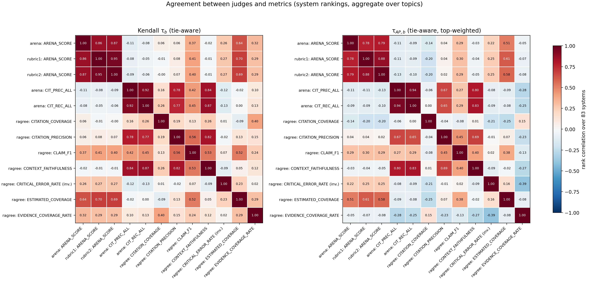
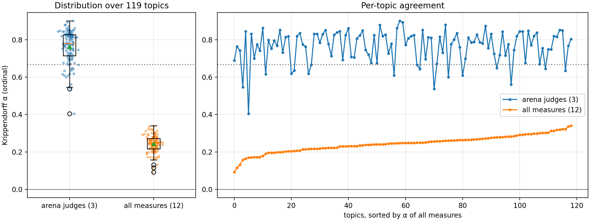

# Judge and metric agreement analysis

Diagnostics over the four uploaded runs (`ragree-default`, `arena-support`,
`arena-rubric-support-arena`, `arena-rubric-v2-support-arena`), 83 systems, 119 topics. Inputs are
only the scored `*.eval.txt` outputs (aggregate `topic == all` rows and per-topic rows); no run
content is read. Inputs live under `output/rag26-generation/` on sunfyre (not committed).

## Scripts

| Script | What it does |
|---|---|
| `scripts/compare_runs.py` | Mean arena diagnostics, Spearman/Kendall across runs, ragree-vs-arena correlations |
| `scripts/agreement_heatmap.py` | Pairwise Kendall tau_b and tauAP_b heatmap (tie-aware) |
| `scripts/topic_alpha.py` | Per-topic Krippendorff's alpha (ordinal) |
| `scripts/agreement_table.py` | Merges the above CSVs into `docs/figures/agreement_values.tsv` |

```bash
E=path/to/evals   # arena-support.txt rubric-v1.txt rubric-v2.txt ragree.txt
python scripts/agreement_heatmap.py docs/figures/judge_agreement arena=$E/arena-support.txt rubric1=$E/rubric-v1.txt rubric2=$E/rubric-v2.txt ragree=$E/ragree.txt
python scripts/topic_alpha.py       docs/figures/topic_alpha     arena=$E/arena-support.txt rubric1=$E/rubric-v1.txt rubric2=$E/rubric-v2.txt ragree=$E/ragree.txt
python scripts/agreement_table.py
```

## Method

- **tau_b / tauAP_b**: tie-aware "agreement" variants of Kendall tau and Yilmaz tauAP from
  Urbano & Marrero, *The Treatment of Ties in AP Correlation*, ICTIR 2017. Ported from the R
  package [`ircor`](https://github.com/julian-urbano/ircor); checked against its README values.
  tauAP_b is top-weighted. Lower-is-better measures (`CRITICAL_ERROR_RATE`) are negated.
- **Krippendorff's alpha (ordinal)**: per topic, annotators = the 12 metric columns, units = systems.
  Scores become within-topic ranks (ties share average rank) so different scales share one ordinal
  domain. Sanity-checked: identical raters 1, random about 0, reversed below -0.9.

## Findings

- Arena judges agree closely: tau_b 0.86 (arena-support vs rubric), 0.95 (rubric v1 vs v2).
  tauAP_b is lower (0.78-0.88), so disagreement concentrates at the top of the ranking.
- Rubric variants raise both-bad rate (0.17 to about 0.38) and position-reversal disagreement
  (0.15 to 0.20-0.21); v2 barely changes the ranking relative to v1.
- Arena score tracks ragree `ESTIMATED_COVERAGE` (tau_b 0.64-0.70), `CLAIM_F1` about 0.4.
- Citation metrics (arena `CIT_*`, ragree `CITATION_PRECISION`, `CONTEXT_FAITHFULNESS`) form a
  separate block with about zero correlation to the arena score.
- Per-topic alpha: arena judges mean 0.76 (range 0.40-0.90); all 12 measures mean 0.24 (0.09-0.34).
  Low all-measure alpha reflects different constructs, not noisy judges.

Ballot-level statistics (Kemeny agreement, win/tie/abstain splits) are not in `*.eval.txt` and
are not covered.

## Outputs (`docs/figures/`)

- `judge_agreement.png/.pdf`: heatmaps; `judge_agreement_tau_b.csv`, `judge_agreement_tauap_b.csv`
- `topic_alpha.png/.pdf`, `topic_alpha.csv`
- `agreement_values.tsv`: all values in long form (`analysis`, `a`, `b`, `value`)




Per-topic values are descriptive only; do not tune judges on them (data policy rule 4).
